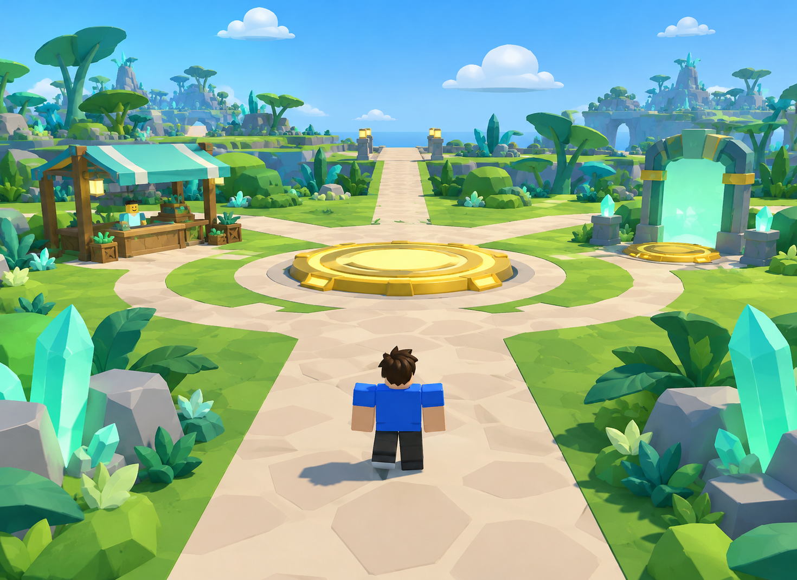
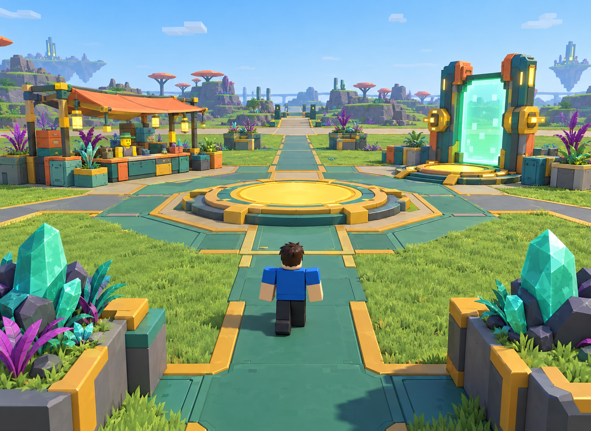
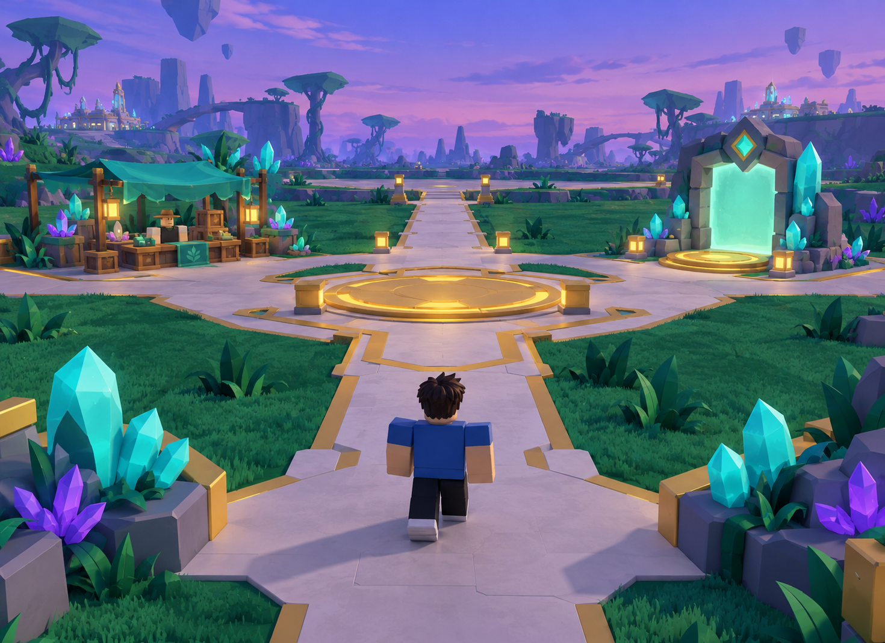

# Glitchbloom — visual design handoff

**Codex: start with [CODEX-PROMPT.md](CODEX-PROMPT.md).** Everything needed for the visual review is in this repository; no folder upload is required.

Claude Design: read [READ-ME-FIRST.txt](READ-ME-FIRST.txt), then [PROMPTS.md](PROMPTS.md).

## New visual concepts — selection pending
The earlier visual style is not approved. These generated images explore replacements; none has been selected yet.

| A — Bright alien garden | B — Salvaged-tech garden | C — Crystal garden |
| --- | --- | --- |
|  |  |  |

Images are style references, not exact layouts, verified gameplay screenshots or importable 3D assets. Their generated scenery does not authorize extra plots, floating islands, changed paths or anchor movement. [Generation prompts](reference/concepts/hub-concept-prompts.txt).

## Source of truth
- [World/UI contracts](docs/CONTRACTS.md)
- [Design snapshot](docs/design-snapshot.md)
- [All 53 anchor positions](Gate0-anchor-positions.csv)
- [World dimensions and palette](src/shared/WorldConfig.luau)
- [Luau world builders](src/shared/world/)
- [Static HUD source](src/client/ui/Hud.client.luau)
- [Studio screenshots](reference/)
- [Anchor checker](tests/anchors/)

This is the Gate 0 visual baseline from gameplay-repository commit `18f3d3f`, not the active gameplay checkout. It intentionally excludes Gate 1 gameplay. The Rojo project file is reference context, not a complete runnable checkout.

Two plots, 700 studs apart. Preserve the supplied anchors and HUD hooks. The CSV positions are derived from the builders; the builders are authoritative. Concept images and HTML/CSS are references for later Roblox implementation, not proof of a successful Studio import.

This repository is private. Claude Design needs authorized GitHub access to read it; a URL alone does not grant access.
